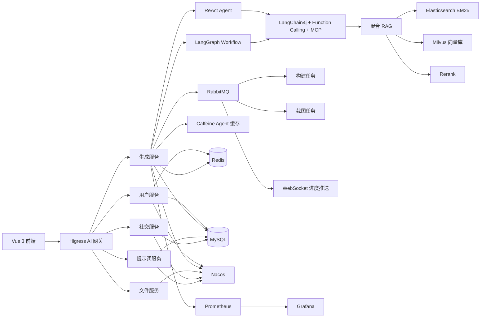

# RichCodeWeaver - 织码睿奇

<div align="center">


**面向数字产物创作全过程的对话式零代码开发平台**

[English](README.md) | 简体中文

[快速开始](#快速开始) | [技术架构](#技术架构) | [核心功能](#核心功能) | [贡献指南](#贡献指南)

</div>

---

## 项目简介

RichCodeWeaver（织码睿奇）是一款独立开发的对话式零代码开发平台，集成需求分析、素材选配、多模式 Agent 代码生成、可视化编辑、项目一键部署、社区交流全流程能力，解决非技术用户开发门槛高、技术人员重复开发效率低的核心问题。

平台将自然语言需求转化为可预览、可编辑、可构建、可部署和可分享的数字产物，并将生成过程中的上下文、知识检索、异步任务和运行状态完整串联起来。

### 解决的问题

- **个人用户**：有明确的页面或应用想法，但缺少完整的开发能力。
- **商户用户**：需要快速搭建宣传页面、业务展示等数字产物。
- **企业团队**：通用 AI 工具生成的代码分散、难预览、难修改，难以形成可部署、可传播、可协作的完整产物。

### 与通用 AI 代码助手对比

| 对比维度 | 通用 AI 代码助手 | 织码睿奇 |
|---|---|---|
| 主要输入方式 | 文本指令、代码补全 | 自然语言、提示词优化、行业模板、多模式 Agent |
| 主要输出形态 | 代码片段或局部工程 | 单页代码、多文件代码、完整 Vue 工程 |
| 修改方式 | 继续提问或手工修改代码 | 对话修改、可视化编辑、构建校验 |
| 落地能力 | 往往需要用户自行收尾 | 预览、构建、部署、分享形成闭环 |
| 协作互动 | 能力相对有限 | 点赞、收藏、评论、分享、协作邀请、社区 |
| 面向人群 | 以开发者为主 | 同时面向普通用户、商户、企业团队和开发者 |

---

## 项目亮点

1. **双 Agent 架构优化**：针对单一 Agent 模式任务处理效率低、流程不灵活的痛点，开发 **ReAct 模式**（拆分任务列表执行）和 **LangGraph Workflow 模式**（工作流节点异步执行）两种 Agent 架构，结合 **Function Calling** 与 **MCP** 服务完善 Agent 核心能力。
2. **本地 RAG 知识增强体系**：针对大模型在快速落地用户需求时经验不足、策略不可控等问题，构建本地 RAG 知识库全流程，搭建包含**向量 + BM25 混合检索、Rerank** 的检索链路，将专业知识注入生成流程，大幅提升 Agent 实际落地用户需求的能力。
3. **上下文模型优化**：针对 Agent 对话上下文受限、记忆杂乱、用户信息零散的痛点，通过**滑动窗口**管理短期记忆、凝练近期对话摘要、构建**用户结构化知识图谱**，提升多轮对话上下文准确率。
4. **线程执行优化**：针对 Agent 工作流执行、资源收集等模块阻塞严重的问题，基于 **JDK 21 虚拟线程 + CompletableFuture 异步线程池**实现异步执行，经测试单应用生成平均耗时减少 **20%~35%**。
5. **流量削峰与异步解耦**：针对项目构建、产物截图生成等业务峰值压力大、响应延迟的问题，引入 **RabbitMQ** 消息队列实现流量削峰、异步解耦，搭配 **WebSocket** 实时推送队列任务执行进度。
6. **Agent 实例缓存优化**：对高频对话场景下 Agent 服务实例重复创建、内存占用过高的问题，集成 **Caffeine** 本地缓存来缓存 Agent 服务实例，规避对象重复创建，提升系统内存利用率。
7. **线上系统高可用性、可观测性**：通过事件监听器采集 AI 调用核心指标并上报 **Prometheus**，搭配 **Grafana** 完成可视化监控，并整合 **Spring Cloud、Dubbo、Nacos 与 Higress AI 网关**搭建完整的微服务架构。

---

## 技术栈

**核心技术栈：** Spring Cloud、LangChain4j、LangGraph4j、Elasticsearch、Milvus、MySQL、MyBatis-Flex、Redis、Caffeine、WebSocket、RabbitMQ。

### 后端技术栈

| 技术 | 版本 | 说明 |
|---|---|---|
| Java | 21 | 核心开发语言，支持虚拟线程 |
| Spring Boot | 3.3.4 | 应用框架 |
| Spring Cloud | 2023.0.3 | 微服务框架 |
| Spring Cloud Alibaba | 2023.0.1.2 | 阿里云微服务组件 |
| Apache Dubbo | 3.3.0 | RPC 与服务治理 |
| Nacos | 2.x | 服务注册与配置中心 |
| Higress | - | AI 网关与统一流量入口 |
| Sentinel | 1.8+ | 流量控制与熔断降级 |
| MyBatis-Flex | 1.11.1 | ORM 框架 |
| MySQL | 8.0.33 | 业务数据持久化 |
| Redis | 6.0+ | 缓存、分布式锁与对话记忆 |
| Redisson | 3.50.0 | Redis 客户端与分布式限流 |
| RabbitMQ | 3.x | 异步任务、流量削峰与业务解耦 |
| Caffeine | Spring Boot 管理 | Agent 服务实例本地缓存 |
| WebSocket | Spring WebSocket / STOMP | 实时任务进度与协作事件 |
| LangChain4j | 1.1.0 | AI 应用开发框架 |
| LangGraph4j | 1.6.0-rc2 | 工作流编排 |
| MCP | LangChain4j MCP 集成 | 工具与服务互操作 |
| Elasticsearch | 8.x | RAG 的 BM25 关键词召回 |
| Milvus | 2.5.9 SDK | 向量存储与相似度检索 |
| PostgreSQL + pgvector | 可选 | 兼容已有向量库部署 |
| Prometheus | 3.11.2 | 监控指标采集 |
| Grafana | 12.1.0 | 可视化监控看板 |
| 阿里云百炼 DashScope | 2.21.1 | 模型与向量服务 |

### 前端技术栈

| 技术 | 版本 | 说明 |
|---|---|---|
| Vue | 3.5.17 | 前端框架 |
| TypeScript | 5.8.0 | 类型安全 |
| Vite | 7.0.0 | 构建工具与开发服务器 |
| Vue Router | 4.5.1 | 路由管理 |
| Pinia | 3.0.3 | 状态管理 |
| Ant Design Vue | 4.2.6 | 桌面端 UI 组件 |
| Element Plus | 2.13.7 | 补充 UI 组件 |
| Vant | 4.9.21 | 移动端 UI 组件 |
| Axios | 1.11.0 | HTTP 客户端 |
| Markdown-it | 14.1.0 | Markdown 渲染 |
| md-editor-v3 | 6.4.1 | Markdown 编辑器 |
| SockJS / STOMP | 1.6.1 / 2.3.3 | WebSocket 通信 |
| EventSource | 浏览器原生 API | SSE 流式响应与断线续接 |

### AI 模型

| 类型 | 模型 | 主要用途 |
|---|---|---|
| 通用与代码对话 | qwen-plus-2025-12-01 | 提示词优化、策略判断、AI 客服 |
| 代码生成 | qwen3-coder-plus-2025-09-23 | 流式代码生成与 Agent 规划 |
| 向量模型 | text-embedding-v4 | RAG 知识向量化 |
| 重排序模型 | qwen3-vl-rerank | 混合检索结果重排序 |
| 文生图 | wan2.2-t2i-flash | Logo 与视觉素材生成 |

---

## 技术架构



### 生成链路

1. 用户提交需求与可选素材。
2. 提示词增强模块补全意图并匹配行业模板。
3. 系统根据任务特点选择 ReAct Agent 或 LangGraph Workflow。
4. 混合 RAG 通过向量检索与 BM25 召回知识，再使用 Rerank 精排。
5. 代码生成模块输出单页、多文件或 Vue 工程产物。
6. 项目构建与截图任务通过 RabbitMQ 异步执行。
7. WebSocket 将任务进度与结果实时推送到前端。
8. 用户完成预览、可视化编辑、部署与分享。

---

## 仓库模块

| 模块 | 主要职责 | 端口 |
|---|---|---|
| rich-code-weaver-common | 公共工具、常量、异常与基础设施 | - |
| rich-code-weaver-model | 实体、DTO、VO 与共享领域模型 | - |
| rich-code-weaver-client | Dubbo 内部服务接口 | - |
| rich-code-weaver-generator | 核心生成引擎、Agent 编排、构建与部署流程 | 8101 |
| rich-code-weaver-user | 认证、用户、权限、好友与协作 | 8102 |
| rich-code-weaver-file | 文件上传、OSS 存储与素材管理 | 8103 |
| rich-code-weaver-social | 点赞、收藏、评论、分享、排行与社区 | 8104 |
| rich-code-weaver-prompt | 提示词模板、行业匹配与动态字段 | 8105 |
| rich-code-weaver-ai | LangChain4j 集成、RAG、记忆、工具与缓存 | - |
| rich-code-weaver-server-admin | 可选的 Spring Boot Admin 监控控制台 | 9001 |
| rich-code-weaver-web | Vue 3 前端 | 5174 |

---

## 快速开始

### 环境要求

| 环境项 | 版本要求 | 说明 |
|---|---|---|
| JDK | 21+ | 后端运行环境，支持虚拟线程 |
| Maven | 3.8+ | 后端构建工具 |
| Node.js | 20.19+ 或 22.12+ | 前端运行环境，满足 Vite 7 要求 |
| MySQL | 8.0+ | 业务数据持久化 |
| Redis | 6.0+ | 缓存、分布式锁与对话记忆 |
| RabbitMQ | 3.x | 构建、截图等异步任务 |
| Nacos | 2.x | 服务注册与配置中心 |
| Elasticsearch | 8.x | BM25 关键词召回 |
| Milvus | 2.5+ | 向量存储与相似度检索 |
| PostgreSQL + pgvector | 可选 | 兼容已有向量库部署 |
| Nginx | - | 生产环境静态资源与反向代理 |
| Prometheus + Grafana | 可选 | 指标采集与可视化监控 |

### 1. 克隆项目

```bash
git clone https://github.com/Moo-Jie/rich-code-weaver-agent
cd rich-code-weaver-agent
```

### 2. 初始化数据库

```bash
mysql -u root -p
CREATE DATABASE rich_code_weaver CHARACTER SET utf8mb4 COLLATE utf8mb4_unicode_ci;

mysql -u root -p rich_code_weaver < docs/sql/sql/RichCodeWeaverDB_MySQL.sql

# 可选：导入 PostgreSQL + pgvector 脚本
gunzip -c docs/sql/sql/RichCodeWeaverDB_PgSQL.gz | psql -U postgres -d rich_code_weaver_vector
```

### 3. 启动基础设施

根据实际部署方式启动以下服务：

- Redis：会话、缓存、分布式锁与对话记忆。
- RabbitMQ：构建、截图等异步任务。
- Nacos：服务注册与配置中心。
- Elasticsearch：BM25 关键词检索。
- Milvus：向量检索。
- Prometheus 与 Grafana：启用监控时启动。

`bat/` 目录提供了 Windows 辅助脚本，包括 Redis、Nacos、Prometheus、Grafana、Nginx 和一键启动脚本。脚本中包含本地路径，请按实际环境修改。

### 4. 配置服务

将各模块的 `application-local-tmp.yml` 复制为 `application-local.yml`，重点配置：

- MySQL 与 Redis 连接。
- RabbitMQ 交换机、队列与连接参数。
- Nacos 地址与命名空间。
- DashScope API Key 与模型地址。
- Milvus 连接与集合配置。
- Elasticsearch URI 与索引名称。
- RAG 存储类型、Embedding 模型与 Rerank 模型。
- OSS 文件与图片存储配置。
- 注册验证码所需的 SMTP 配置。
- 管理端使用的 Higress 与 Grafana 地址。

当前 Milvus 部署将 `rag.store-type` 设置为 `milvus`；已有环境可以继续使用 `pgvector`。

### 5. 启动后端

在仓库根目录启动各服务：

```bash
mvn -pl rich-code-weaver-generator spring-boot:run
mvn -pl rich-code-weaver-user spring-boot:run
mvn -pl rich-code-weaver-file spring-boot:run
mvn -pl rich-code-weaver-social spring-boot:run
mvn -pl rich-code-weaver-prompt spring-boot:run
mvn -pl rich-code-weaver-server-admin spring-boot:run
```

服务端口：

- `8101`：generator
- `8102`：user
- `8103`：file
- `8104`：social
- `8105`：prompt
- `9001`：admin

### 6. 启动前端

```bash
cd rich-code-weaver-web
npm install
npm run dev
```

浏览器访问 <http://localhost:5174>。

本地演示账号：

- 邮箱：`rcwadmin@outlook.com`
- 密码：`richCodeWeaverAdmin`

> 在非本地环境部署前，请立即修改默认凭据。

---

## 核心功能

### 多模式 Agent 生成

- **LangGraph Workflow**：节点化流程、阶段清晰、带校验护轨，适合结构相对明确的生成任务。
- **ReAct Agent**：自主拆解任务、选择工具、制定计划并连续推进，适合工程化程度更高的复杂任务。
- **MCP 与 Function Calling**：通过标准协议为 Agent 提供可复用工具与外部能力。

### 混合 RAG 检索

1. 对知识文档进行语义切分。
2. 使用 `text-embedding-v4` 生成向量。
3. 将向量写入 Milvus，将关键词内容写入 Elasticsearch。
4. 并行执行向量召回与 BM25 召回，合并候选结果并使用 `qwen3-vl-rerank` 精排。
5. 将高价值知识注入生成提示词。

### 上下文工程

- 滑动窗口管理长对话。
- 滚动摘要压缩较早的上下文。
- 构建结构化用户画像与知识图谱，支持长期个性化。
- 支持断线续接，刷新页面不会丢失当前生成状态。

### 数字产物全生命周期

- 单页 HTML 产物。
- 多文件项目、文件树展示与批量下载。
- 完整 Vue 3 + Vite 工程，自动安装依赖并执行构建校验。
- 支持预览、可视化编辑、构建、部署、分享与协作。

### 实时交互

- SSE 流式返回模型输出。
- 服务端缓存流式事件，支持断线续接。
- WebSocket/STOMP 推送任务进度、通知与协作事件。
- RabbitMQ 异步执行耗时任务，降低主链路响应时间。

### 社区与协作

- 点赞、收藏、评论与分享统计。
- 综合权重热度排行。
- 协作邀请与多人编辑。
- 社区发帖、回复与经验沉淀。
- 基于产品知识库的 AI 客服。

### 素材管理

- 支持图片、文本、视频、音频与链接。
- 按类别组织和管理素材。
- 在生成工作台中直接选择素材。
- 复用本地与云端素材，减少重复输入。

---

## 数据与存储

| 数据分类 | 核心表 | 主要作用 |
|---|---|---|
| 用户与身份 | user、user_friendship | 登录、权限、好友与个性化 |
| 产物与协作 | app、app_collaborator | 产物归属、协作编辑与团队创作 |
| 生成过程 | chat_history | 多轮记忆与过程回溯 |
| 社交传播 | app_hot_stat、app_like、app_favorite、app_share、app_comment | 热度排行、行为反馈与传播分析 |
| 社区交流 | community_post、community_reply | 经验沉淀、问题讨论与内容运营 |
| AI 配置与知识 | prompt_template、rag_document、rag_param、system_prompt | 模板、知识与提示词配置 |
| AI 客服 | customer_service_conversation、customer_service_message | 持续答疑与历史沉淀 |
| 素材管理 | material、material_category | 复用媒体与内容资产 |

存储职责：

- **MySQL**：业务事务数据。
- **Redis**：缓存、会话、分布式锁与对话记忆。
- **Milvus**：RAG 稠密向量索引。
- **Elasticsearch**：BM25 混合检索索引。
- **RabbitMQ**：异步任务队列。
- **OSS**：上传文件与生成媒体资源。

---

## API 文档与可观测性

### Knife4j / OpenAPI

- 产物生成模块：<http://localhost:8101/doc.html>
- 用户模块：<http://localhost:8102/doc.html>
- 文件模块：<http://localhost:8103/doc.html>
- 社交模块：<http://localhost:8104/doc.html>
- 提示词模块：<http://localhost:8105/doc.html>

生成前端 API 客户端：

```bash
cd rich-code-weaver-web
npm run openapi2ts
```

### 监控与运维

- **Prometheus**：<http://localhost:9090>
- **Grafana**：<http://localhost:3000>
- **Spring Boot Admin**：<http://localhost:9001>

监控看板：

- `docs/grafana/ai_model_monitoring_dashboard.json`
- `docs/grafana/higress-dashboard.json`

监控指标包括 AI 请求次数、Token 消耗、响应时长、错误率、Agent 执行进度与队列积压等。

---

## 生产部署

### 构建

```bash
mvn clean package -DskipTests

cd rich-code-weaver-web
npm run build
```

### 推荐目录

```bash
mkdir -p /opt/RichCodeWeaver/{server,web,middleware,logs}
```

- `server/`：后端 JAR。
- `web/`：前端构建产物。
- `middleware/`：Nacos、RabbitMQ、Elasticsearch、Milvus、Prometheus、Grafana 等中间件。
- `logs/`：应用与中间件日志。

静态资源与反向代理配置可参考 `bat/nginx.conf`，详细部署步骤见 `docs/设计和开发文档.md`。

---

## 贡献指南

欢迎提交代码、Issue 和功能建议。

1. Fork 本仓库。
2. 创建特性分支：`git checkout -b feature/AmazingFeature`。
3. 提交修改：`git commit -m "feat: add an amazing feature"`。
4. 推送分支：`git push origin feature/AmazingFeature`。
5. 提交 Pull Request。

### 工程规范

- 后端遵循《阿里巴巴 Java 开发手册》。
- 前端遵循 Vue 官方风格指南。
- 提交信息遵循 Conventional Commits。
- 面向用户的改动应包含对应流程的验证结果。

---

## 许可证

本项目采用 MIT License，详见 [LICENSE](LICENSE)。

---

## 作者

**MO-JIE-RUBY TEAM**

- GitHub：[rich-code-weaver-agent](https://github.com/Moo-Jie/rich-code-weaver-agent)
- Email：NotProvidedTemporarily@xxx.com

---

## 致谢

- [Spring Boot](https://spring.io/projects/spring-boot)
- [Vue.js](https://vuejs.org/)
- [LangChain4j](https://github.com/langchain4j/langchain4j)
- [LangGraph4j](https://github.com/bsorrentino/langgraph4j)
- [MyBatis-Flex](https://mybatis-flex.com/)
- [Ant Design Vue](https://antdv.com/)

---

## 联系我们

- 仓库地址：<https://github.com/Moo-Jie/rich-code-weaver-agent>
- Issue：<https://github.com/Moo-Jie/rich-code-weaver-agent>
- Email：NotProvidedTemporarily@xxx.com

---

<div align="center">

**如果这个项目对你有帮助，请给个 Star 支持一下。**

Made with care by MO-JIE-RUBY TEAM.

</div>