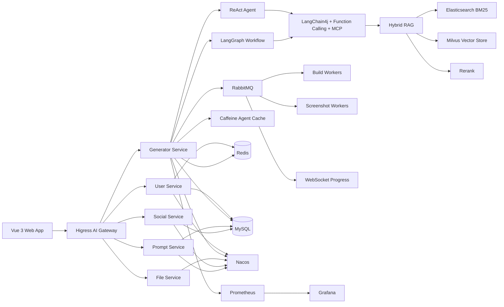

# RichCodeWeaver

<div align="center">


**A conversational zero-code development platform for the complete lifecycle of digital products**

English | [Chinese](README-CN.md)

[Quick Start](#quick-start) | [Architecture](#architecture) | [Core Capabilities](#core-capabilities) | [Contributing](#contributing)

</div>

---

## Overview

RichCodeWeaver is an independently developed, conversational zero-code development platform. It brings requirement analysis, material selection, multi-mode Agent-based code generation, visual editing, one-click project deployment, and community collaboration into a single workflow.

The platform is designed to solve two common problems:

- **For non-technical users:** turning an idea into a runnable website or application still requires a complete development toolchain.
- **For technical teams:** repeated scaffolding, preview, build, deployment, and collaboration work consumes time that should be spent on higher-value engineering.

RichCodeWeaver turns a natural-language requirement into a deployable digital artifact and keeps the full process observable, editable, and shareable.

### Why RichCodeWeaver

| Dimension | General AI coding assistant | RichCodeWeaver |
|---|---|---|
| Input | Plain text or code completion | Natural language, prompt enhancement, industry templates, and selectable Agent modes |
| Output | Snippets or partial projects | Single-page apps, multi-file projects, and complete Vue projects |
| Editing | Follow-up prompts or manual code changes | Conversational editing, visual editing, and build validation |
| Delivery | Usually requires manual finishing | Preview, build, deployment, and sharing in one workflow |
| Collaboration | Limited | Likes, favorites, comments, sharing, invitations, and community |
| Audience | Primarily developers | Non-technical users, merchants, teams, and developers |

---

## Project Highlights

1. **Dual-agent architecture**
   - Built two generation architectures for different task shapes: a **ReAct Agent** that decomposes work into executable task lists, and a **LangGraph Workflow** that runs workflow nodes asynchronously.
   - Combined **Function Calling** and **MCP** services to extend Agent capabilities while keeping execution paths controllable.

2. **Local RAG knowledge augmentation**
   - Built an end-to-end local RAG pipeline for domain knowledge and generation experience.
   - Combined **vector retrieval**, **Elasticsearch BM25 keyword retrieval**, and **Rerank** to improve retrieval quality before knowledge is injected into the generation flow.

3. **Context engineering**
   - Uses **sliding-window memory** for short-term context.
   - Condenses recent conversations into summaries and maintains a structured user knowledge graph to improve multi-turn accuracy.

4. **Asynchronous execution optimization**
   - Uses **JDK 21 virtual threads** and a **CompletableFuture** thread pool for workflow execution, resource collection, and other blocking stages.
   - Internal testing showed an average reduction of **20%–35%** in generation time per application.

5. **Traffic shaping and asynchronous decoupling**
   - Uses **RabbitMQ** to absorb traffic spikes and decouple project builds, screenshot generation, and other background tasks.
   - Uses **WebSocket** to push queue and task progress to the frontend in real time.

6. **Agent instance caching**
   - Uses **Caffeine** as a local cache for Agent service instances in high-frequency conversation scenarios.
   - Avoids repeated object creation and reduces unnecessary memory pressure.

7. **High availability and observability**
   - Collects core AI-call metrics through event listeners and reports them to **Prometheus**.
   - Provides dashboards with **Grafana** and combines **Spring Cloud**, **Dubbo**, **Nacos**, and the **Higress AI Gateway** into a complete microservice architecture.

---

## Tech Stack

**Core stack:** Spring Cloud, LangChain4j, LangGraph4j, Elasticsearch, Milvus, MySQL, MyBatis-Flex, Redis, Caffeine, WebSocket, RabbitMQ.

### Backend

| Technology | Version | Purpose |
|---|---|---|
| Java | 21 | Core language; supports virtual threads |
| Spring Boot | 3.3.4 | Application framework |
| Spring Cloud | 2023.0.3 | Microservice framework |
| Spring Cloud Alibaba | 2023.0.1.2 | Alibaba Cloud microservice components |
| Apache Dubbo | 3.3.0 | RPC and service governance |
| Nacos | 2.x | Service registration and configuration center |
| Higress | - | AI gateway and traffic entry point |
| Sentinel | 1.8+ | Flow control and circuit breaking |
| MyBatis-Flex | 1.11.1 | ORM framework |
| MySQL | 8.0.33 | Transactional business data |
| Redis | 6.0+ | Cache, distributed locks, and conversation memory |
| Redisson | 3.50.0 | Redis client and distributed rate limiting |
| RabbitMQ | 3.x | Asynchronous tasks, traffic shaping, and decoupling |
| Caffeine | Managed by Spring Boot | Local cache for Agent service instances |
| WebSocket | Spring WebSocket / STOMP | Real-time task progress and collaboration events |
| LangChain4j | 1.1.0 | AI application framework |
| LangGraph4j | 1.6.0-rc2 | Workflow orchestration |
| MCP | LangChain4j MCP integration | Tool and service interoperability |
| Elasticsearch | 8.x | BM25 keyword retrieval for hybrid RAG |
| Milvus | 2.5.9 SDK | Dense-vector storage and retrieval |
| PostgreSQL + pgvector | Optional | Compatibility option for existing vector-store deployments |
| Prometheus | 3.11.2 | Metrics collection |
| Grafana | 12.1.0 | Observability dashboards |
| Alibaba Cloud DashScope | 2.21.1 | Model and embedding services |

### Frontend

| Technology | Version | Purpose |
|---|---|---|
| Vue | 3.5.17 | Frontend framework |
| TypeScript | 5.8.0 | Type safety |
| Vite | 7.0.0 | Build tool and development server |
| Vue Router | 4.5.1 | Routing |
| Pinia | 3.0.3 | State management |
| Ant Design Vue | 4.2.6 | Desktop UI components |
| Element Plus | 2.13.7 | Additional UI components |
| Vant | 4.9.21 | Mobile UI components |
| Axios | 1.11.0 | HTTP client |
| Markdown-it | 14.1.0 | Markdown rendering |
| md-editor-v3 | 6.4.1 | Markdown editor |
| SockJS / STOMP | 1.6.1 / 2.3.3 | WebSocket communication |
| EventSource | Native browser API | SSE streaming and reconnect support |

### AI Models

| Type | Model | Main use |
|---|---|---|
| General and code dialogue | qwen-plus-2025-12-01 | Prompt enhancement, strategy selection, AI support |
| Code generation | qwen3-coder-plus-2025-09-23 | Streaming code generation and Agent planning |
| Embedding | text-embedding-v4 | RAG vectorization |
| Rerank | qwen3-vl-rerank | Hybrid-retrieval result reranking |
| Text-to-image | wan2.2-t2i-flash | Logo and visual material generation |

---

## Architecture



### Generation Pipeline

1. User submits a requirement and optional materials.
2. The prompt-enhancement layer clarifies intent and selects an industry template.
3. The system chooses either the ReAct Agent or LangGraph Workflow.
4. Hybrid RAG retrieves relevant knowledge using vector search and BM25, then reranks the results.
5. The code generator emits a single-file, multi-file, or Vue project artifact.
6. The build and screenshot stages run asynchronously through RabbitMQ.
7. WebSocket pushes progress and results to the frontend.
8. The user previews, edits visually, deploys, and shares the artifact.

---

## Repository Modules

| Module | Responsibility | Port |
|---|---|---|
| rich-code-weaver-common | Shared utilities, constants, exceptions, and infrastructure | - |
| rich-code-weaver-model | Entities, DTOs, VOs, and shared domain models | - |
| rich-code-weaver-client | Internal Dubbo service contracts | - |
| rich-code-weaver-generator | Core generation engine, Agent orchestration, build and deployment flow | 8101 |
| rich-code-weaver-user | Authentication, users, permissions, friends, and collaboration | 8102 |
| rich-code-weaver-file | File upload, OSS storage, and material management | 8103 |
| rich-code-weaver-social | Likes, favorites, comments, sharing, ranking, and community | 8104 |
| rich-code-weaver-prompt | Prompt templates, industry matching, and dynamic fields | 8105 |
| rich-code-weaver-ai | LangChain4j integration, RAG, memory, tools, and caching | - |
| rich-code-weaver-server-admin | Optional Spring Boot Admin monitoring console | 9001 |
| rich-code-weaver-web | Vue 3 frontend | 5174 |

---

## Quick Start

### Prerequisites

| Dependency | Requirement | Notes |
|---|---|---|
| JDK | 21+ | Required for virtual threads |
| Maven | 3.8+ | Backend build |
| Node.js | 20.19+ or 22.12+ | Frontend build; Vite 7 requirement |
| MySQL | 8.0+ | Business database |
| Redis | 6.0+ | Cache, locks, and conversation memory |
| RabbitMQ | 3.x | Asynchronous build and screenshot tasks |
| Nacos | 2.x | Service registration and configuration |
| Elasticsearch | 8.x | BM25 retrieval |
| Milvus | 2.5+ | Dense-vector retrieval |
| PostgreSQL + pgvector | Optional | Existing/alternative vector-store support |
| Nginx | - | Static hosting and reverse proxy in production |
| Prometheus + Grafana | Optional | Metrics and dashboards |

### 1. Clone the Repository

```bash
git clone https://github.com/Moo-Jie/rich-code-weaver-agent
cd rich-code-weaver-agent
```

### 2. Initialize the Database

```bash
mysql -u root -p
CREATE DATABASE rich_code_weaver CHARACTER SET utf8mb4 COLLATE utf8mb4_unicode_ci;

mysql -u root -p rich_code_weaver < docs/sql/sql/RichCodeWeaverDB_MySQL.sql

# Optional: import the PostgreSQL + pgvector schema
gunzip -c docs/sql/sql/RichCodeWeaverDB_PgSQL.gz | psql -U postgres -d rich_code_weaver_vector
```

### 3. Start the Infrastructure

Start the services required by your chosen configuration:

- Redis for sessions, caching, distributed locks, and conversation memory.
- RabbitMQ for build, screenshot, and other asynchronous workloads.
- Nacos for service registration and configuration.
- Elasticsearch for BM25 keyword retrieval.
- Milvus for dense-vector retrieval.
- Prometheus and Grafana when monitoring is enabled.

Windows helper scripts are available in `bat/`, including Redis, Nacos, Prometheus, Grafana, Nginx, and the all-in-one launcher. The scripts contain local paths and may need to be adjusted for your environment.

### 4. Configure the Services

Copy each module's `application-local-tmp.yml` to `application-local.yml`, then configure:

- MySQL and Redis connections.
- RabbitMQ exchange, queue, and connection settings.
- Nacos address and namespace.
- DashScope API key and model endpoints.
- Milvus connection and collection settings.
- Elasticsearch URI and index name.
- RAG store type, embedding model, and rerank model.
- OSS credentials for file and image storage.
- SMTP settings for email verification.
- Higress and Grafana URLs used by the admin frontend.

Set `rag.store-type` to `milvus` for the current Milvus-based deployment. Existing environments may continue to use `pgvector`.

### 5. Start the Backend

Run the services from the repository root:

```bash
mvn -pl rich-code-weaver-generator spring-boot:run
mvn -pl rich-code-weaver-user spring-boot:run
mvn -pl rich-code-weaver-file spring-boot:run
mvn -pl rich-code-weaver-social spring-boot:run
mvn -pl rich-code-weaver-prompt spring-boot:run
mvn -pl rich-code-weaver-server-admin spring-boot:run
```

Service ports:

- `8101`: generator
- `8102`: user
- `8103`: file
- `8104`: social
- `8105`: prompt
- `9001`: admin

### 6. Start the Frontend

```bash
cd rich-code-weaver-web
npm install
npm run dev
```

Open <http://localhost:5174>.

Local demo account:

- Email: `rcwadmin@outlook.com`
- Password: `richCodeWeaverAdmin`

> Change the default credentials before exposing the system outside a local environment.

---

## Core Capabilities

### Multi-Mode Agent Generation

- **LangGraph Workflow:** explicit stages, predictable execution, validation guards, and stable results for structured tasks.
- **ReAct Agent:** task decomposition, tool selection, continuous planning, and multi-step execution for open-ended engineering tasks.
- **MCP and Function Calling:** reusable tools and external capabilities exposed to Agents through a standard protocol.

### Hybrid RAG Pipeline

1. Split knowledge documents while preserving semantic boundaries.
2. Generate embeddings with `text-embedding-v4`.
3. Store dense vectors in Milvus and index keyword content in Elasticsearch.
4. Run vector and BM25 retrieval, merge candidates, and apply `qwen3-vl-rerank`.
5. Inject the highest-value context into the generation prompt.

### Context Engineering

- Sliding-window management for long conversations.
- Rolling summaries for older dialogue.
- Structured user profiles and knowledge graphs for long-term personalization.
- Reconnect support so a page refresh does not lose the active generation state.

### Artifact Lifecycle

- Single-page HTML artifacts.
- Multi-file projects with a file tree and batch download.
- Complete Vue 3 + Vite projects with dependency installation and build validation.
- Preview, visual editing, build, deployment, sharing, and collaboration.

### Real-Time Interaction

- SSE for streaming model output.
- Server-side event caching with reconnect support.
- WebSocket/STOMP for task progress, notifications, and collaboration events.
- RabbitMQ-backed asynchronous workers for long-running jobs.

### Community and Collaboration

- Likes, favorites, comments, and sharing statistics.
- Weighted popularity ranking.
- Collaboration invitations and multi-user editing.
- Community posts, replies, and knowledge sharing.
- AI support grounded in the product knowledge base.

### Material Management

- Images, text, video, audio, and links.
- Category-based organization.
- Material selection directly inside the generation workspace.
- Reuse of local and cloud-hosted assets.

---

## Data and Storage

| Data category | Core tables | Purpose |
|---|---|---|
| Users and identity | user, user_friendship | Authentication, permissions, friends, personalization |
| Artifacts and collaboration | app, app_collaborator | Ownership, collaboration, and team creation |
| Generation history | chat_history | Multi-turn memory and process reconstruction |
| Social interaction | app_hot_stat, app_like, app_favorite, app_share, app_comment | Ranking, feedback, and sharing analytics |
| Community | community_post, community_reply | Discussions, questions, and knowledge sharing |
| AI configuration | prompt_template, rag_document, rag_param, system_prompt | Templates, knowledge, and prompt configuration |
| AI support | customer_service_conversation, customer_service_message | Persistent support conversations |
| Materials | material, material_category | Reusable media and content assets |

Storage responsibilities:

- **MySQL:** transactional business data.
- **Redis:** cache, sessions, distributed locks, and conversation memory.
- **Milvus:** dense-vector indexes for RAG.
- **Elasticsearch:** BM25 indexes for hybrid retrieval.
- **RabbitMQ:** asynchronous task queues.
- **OSS:** uploaded files and generated media.

---

## API Documentation and Observability

### Knife4j / OpenAPI

- Generator: <http://localhost:8101/doc.html>
- User: <http://localhost:8102/doc.html>
- File: <http://localhost:8103/doc.html>
- Social: <http://localhost:8104/doc.html>
- Prompt: <http://localhost:8105/doc.html>

Generate frontend API clients:

```bash
cd rich-code-weaver-web
npm run openapi2ts
```

### Monitoring

- **Prometheus:** <http://localhost:9090>
- **Grafana:** <http://localhost:3000>
- **Spring Boot Admin:** <http://localhost:9001>

Dashboard templates:

- `docs/grafana/ai_model_monitoring_dashboard.json`
- `docs/grafana/higress-dashboard.json`

Tracked metrics include AI request volume, token usage, latency, error rate, Agent execution progress, and queue backlog.

---

## Production Deployment

### Build

```bash
mvn clean package -DskipTests

cd rich-code-weaver-web
npm run build
```

### Recommended Layout

```bash
mkdir -p /opt/RichCodeWeaver/{server,web,middleware,logs}
```

- `server/`: backend JAR files.
- `web/`: built frontend assets.
- `middleware/`: Nacos, RabbitMQ, Elasticsearch, Milvus, Prometheus, Grafana, and related infrastructure.
- `logs/`: application and middleware logs.

Use `bat/nginx.conf` as the reference for static hosting and reverse-proxy rules. See the [deployment documentation](docs/) for detailed instructions.

---

## Contributing

Contributions, issues, and feature requests are welcome.

1. Fork the repository.
2. Create a feature branch: `git checkout -b feature/AmazingFeature`.
3. Commit your changes: `git commit -m "feat: add an amazing feature"`.
4. Push the branch: `git push origin feature/AmazingFeature`.
5. Open a pull request.

### Engineering Conventions

- Backend code follows the Alibaba Java Coding Guidelines.
- Frontend code follows the Vue style guide.
- Commit messages follow Conventional Commits.
- User-facing changes should include validation for the affected workflow.

---

## License

This project is licensed under the MIT License. See [LICENSE](LICENSE).

---

## Team

**MO-JIE-RUBY TEAM**

- GitHub: [rich-code-weaver-agent](https://github.com/Moo-Jie/rich-code-weaver-agent)
- Email: NotProvidedTemporarily@xxx.com

---

## Acknowledgements

- [Spring Boot](https://spring.io/projects/spring-boot)
- [Vue.js](https://vuejs.org/)
- [LangChain4j](https://github.com/langchain4j/langchain4j)
- [LangGraph4j](https://github.com/bsorrentino/langgraph4j)
- [MyBatis-Flex](https://mybatis-flex.com/)
- [Ant Design Vue](https://antdv.com/)

---

## Contact

- Repository: <https://github.com/Moo-Jie/rich-code-weaver-agent>
- Issues: <https://github.com/Moo-Jie/rich-code-weaver-agent>
- Email: NotProvidedTemporarily@xxx.com

---

<div align="center">

**If this project helps you, please consider giving it a star.**

Made with care by MO-JIE-RUBY TEAM.

</div>